# 九格多源本体构建系统 业务人员使用手册

> 适用对象：业务分析师、运营人员、数据管理员、知识网络维护人员
> 手册更新：2026-11-09

手册按系统左侧菜单组织，重点说明三块业务人员最常用的功能：

1. **领域知识网络**：把业务中的对象、关系和指标组织成一张"业务地图"。
2. **数据资源知识网络**：把企业数据库里的数据表接入系统，变成可查询、可引用的数据资源。
3. **模型管理**：配置智能问答等场景使用的大模型和小模型，并查看使用情况。

手册中的截图均来自当前演示环境，画面中的数据是演示数据。不同版本可能调整按钮位置或字段名称，但操作顺序基本一致。

> **安全提示**：登录密码、数据库密码、API Key 等敏感信息应由管理员通过安全渠道单独保管，不要写进普通文档、聊天记录或截图。

---

## 目录

- [1. 阅读前需要知道的几个概念](#1-阅读前需要知道的几个概念)
- [2. 快速开始](#2-快速开始)
- [3. 领域知识网络](#3-领域知识网络)
- [4. 数据资源知识网络](#4-数据资源知识网络)
- [5. 模型管理](#5-模型管理)
- [6. 执行工厂](#6-执行工厂)
- [7. 常见问题](#7-常见问题)
- [8. 状态速查表](#8-状态速查表)
- [9. 日常使用建议](#9-日常使用建议)
- [附录 A：术语表](#附录-a术语表)
- [附录 B：截图清单](#附录-b截图清单)

---

## 1. 阅读前需要知道的几个概念

### 1.1 用业务语言理解系统

可以把系统理解成一张"企业业务地图"：

| 系统里的名字 | 用业务的话说 | 示例 |
| --- | --- | --- |
| **对象类** | 业务里重要的"名词" | 客户、订单、商品、仓库、供应商 |
| **属性** | 描述这个"名词"的字段 | 客户等级、订单金额、仓库容量 |
| **关系类** | 两个"名词"之间的"动词" | 客户下单、订单由仓库履约、商品属于分类 |
| **概念分组** | 把对象按业务板块归类 | 客户与风险、订单与履约、商品与供应链 |
| **行动类** | 业务上可以执行的动作 | 发起退款审核、冻结风险账户 |
| **数据资源** | 数据库里实际存放数据的一张表 | 客户表、订单表、商品表 |
| **模型** | 支撑智能问答和智能生成的"大脑" | 大语言模型、向量化小模型 |

一句话理解：

> **对象类 + 关系类 = 业务知识网络；数据资源 = 网络背后的真实数据；模型 = 让网络能"听懂人话、回答问题"的能力。**

### 1.2 阅读约定

为了避免与界面名称混淆，本手册统一使用下面的写法：

| 写法 | 含义 |
| --- | --- |
| **领域知识网络** | 点击左侧菜单或页面中名称为"领域知识网络"的入口 |
| `customer_id` | 数据库字段名、技术标识或示例值 |
| "健康""已完成" | 界面上显示的状态文字 |
| **需管理员操作** | 该步骤涉及权限、密钥或技术配置，需要管理员协助 |

### 1.3 使用前准备

开始操作前，请确认：

1. 已从管理员处获得系统地址和登录账号。
2. 知道自己负责的业务范围，例如"订单履约"或"商品供应链"。
3. 需要查看数据时，已获得对应数据资源的查看权限。
4. 需要做修改时，已确认不会影响其他同事正在使用的知识网络。

---

## 2. 快速开始

### 2.1 登录系统

1. 在浏览器地址栏打开管理员提供的系统地址。
2. 在登录页输入**账号**和**密码**。
3. 点击**登录**。
4. 登录成功后进入系统首页。

> 账号和密码由管理员分配。本手册不记录任何真实密码。连续多次输错可能触发安全限制，请通过管理员重置，不要反复尝试。

### 2.2 认识主界面

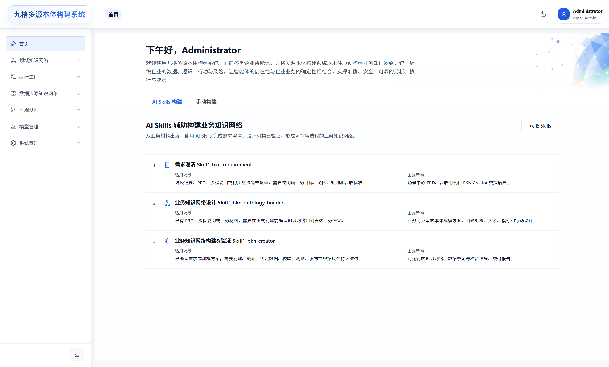

登录后可以看到三个区域：

| 区域 | 位置 | 作用 |
| --- | --- | --- |
| **顶部栏** | 页面最上方 | 显示系统名称、当前页面路径、深色模式切换、当前登录用户 |
| **左侧导航** | 页面左侧 | 系统主要功能入口，点击带下拉箭头的菜单可展开子菜单 |
| **工作区** | 页面中间 | 显示当前功能的内容。首页提供"AI Skills 构建"和"手动构建"两种方式 |

左侧一级菜单包括：

1. **首页**
2. **领域知识网络**：知识网络管理、知识网络对接
3. **执行工厂**：技术同事使用的执行能力
4. **数据资源知识网络**：数据连接、数据目录、任务管理
5. **可观测性**：业务溯源、Trace 分析、日志检索等
6. **模型管理**：模型配置、模型统计
7. **系统管理**：用户、角色、权限

业务人员日常主要使用第 2、4、6 项，也就是本手册的重点。

### 2.3 推荐的上手顺序

第一次使用，建议按下面的顺序熟悉：

```
先看知识网络  →  再看数据资源  →  最后看模型
   (业务地图)      (数据从哪来)     (问答能力从哪来)
```

具体来说：

1. 打开 **领域知识网络 → 知识网络管理**，找到自己负责的知识网络。
2. 进入知识网络，先看**概述**和**概念分组**，建立整体印象。
3. 再看**对象类**和**关系类**，理解业务对象之间怎么关联。
4. 需要查数时，到 **数据资源知识网络 → 数据目录** 查看原始数据。
5. 智能问答不可用时，到 **模型管理** 检查模型和 Agent 是否已配置。

---

## 3. 领域知识网络

### 3.1 它能帮你做什么

领域知识网络把分散在业务文档、数据库和同事头脑里的业务知识，整理成一张结构化的"业务地图"。

以本手册使用的示例"电商供应链与订单风控知识网络"为例，它可以支撑：

- **订单履约分析**：订单从哪里来、由哪个仓库发货、物流走到哪一步。
- **库存预警**：哪些商品库存偏低、由哪个供应商补货。
- **退款追踪**：订单发生了哪些退款、退款与哪些商品和客户有关。
- **风险洞察**：客户、订单和风控事件之间有什么关联。

业务人员不需要写代码，主要工作是**确认对象和关系是否符合业务实际**，以及**用问答验证知识网络是否好用**。

### 3.2 知识网络列表

进入方式：左侧菜单 **领域知识网络 → 知识网络管理**。

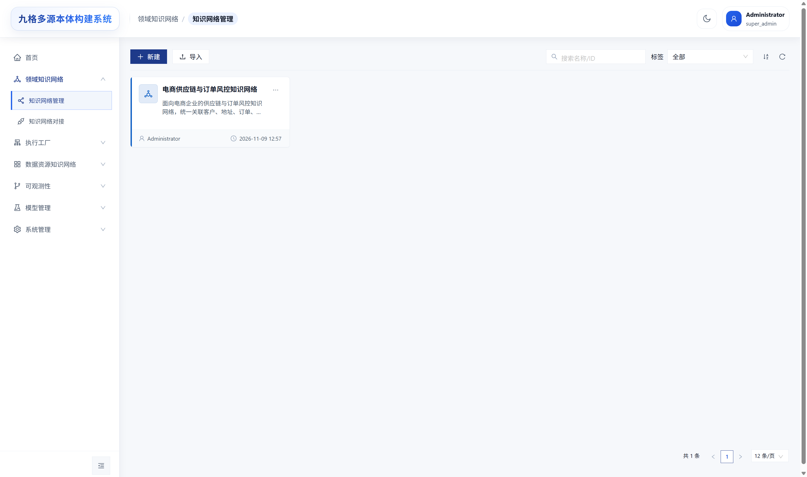

页面说明：

| 元素 | 作用 |
| --- | --- |
| **新建** | 创建一个新的知识网络 |
| **导入** | 从文件导入已有的知识网络 |
| **搜索名称/ID** | 按名称或 ID 快速查找 |
| **标签** | 按标签筛选 |
| **知识网络卡片** | 显示名称、业务描述、修改者和更新时间 |

操作步骤：

1. 在列表中点击目标知识网络的卡片，进入该知识网络的工作台。
2. 如果卡片较多，可以使用搜索框或标签缩小范围。
3. 点击卡片右上角的省略按钮，可以查看重命名、删除等更多操作。

> **建议**：一个知识网络对应一个相对独立的业务主题。不要把互不相关的业务全部塞进同一个网络，否则后续维护和问答都会变复杂。

### 3.3 知识网络工作台

点击知识网络卡片后，进入该知识网络的工作台。

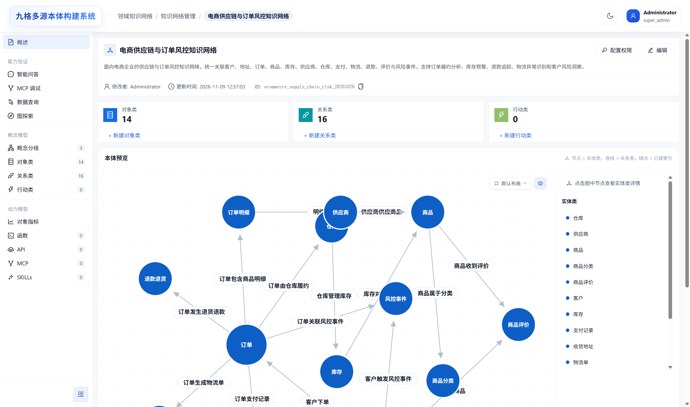

工作台左侧导航分为四组：

| 分组 | 菜单 | 业务人员的用法 |
| --- | --- | --- |
| **概述** | 概述 | 查看知识网络名称、描述、对象类/关系类/行动类数量和本体预览图 |
| **能力验证** | 智能问答 | 用自然语言提问，验证知识网络是否"答得上来" |
|  | 图探索 | 以图的方式浏览实体和关系（需先完成数据索引） |
|  | 数据查询、MCP 调试 | 技术同事排查问题使用，业务人员一般不需要操作 |
| **概念模型** | 概念分组 | 按业务板块给对象分类 |
|  | 对象类 | 查看和维护业务对象 |
|  | 关系类 | 查看和维护对象之间的关系 |
|  | 行动类 | 查看可执行的业务动作 |
| **动力模型** | 对象指标 | 业务指标，例如客单价、退款率 |
|  | 函数、API、MCP、SKILLs | 扩展能力，由技术同事维护 |

**概述页**中，三个数字卡片分别显示对象类、关系类和行动类的数量。下方"本体预览"用图的方式展示整个知识网络：

- **节点**（图中的圆点）= 对象类，例如"订单""商品""仓库"。
- **连线** = 关系类，例如"订单由仓库履约"。
- **绿点** = 该对象已经建立数据索引，可以直接查数。

图中的节点可以点击，右侧会显示对应的实体类详情。

> **提示**：如果节点没有绿点，说明该对象的数据还没有建立索引。此时问答和图探索可能查不到数据，需要到"数据资源知识网络"完成索引构建。

### 3.4 概念分组

进入方式：知识网络工作台左侧点击 **概念分组**。

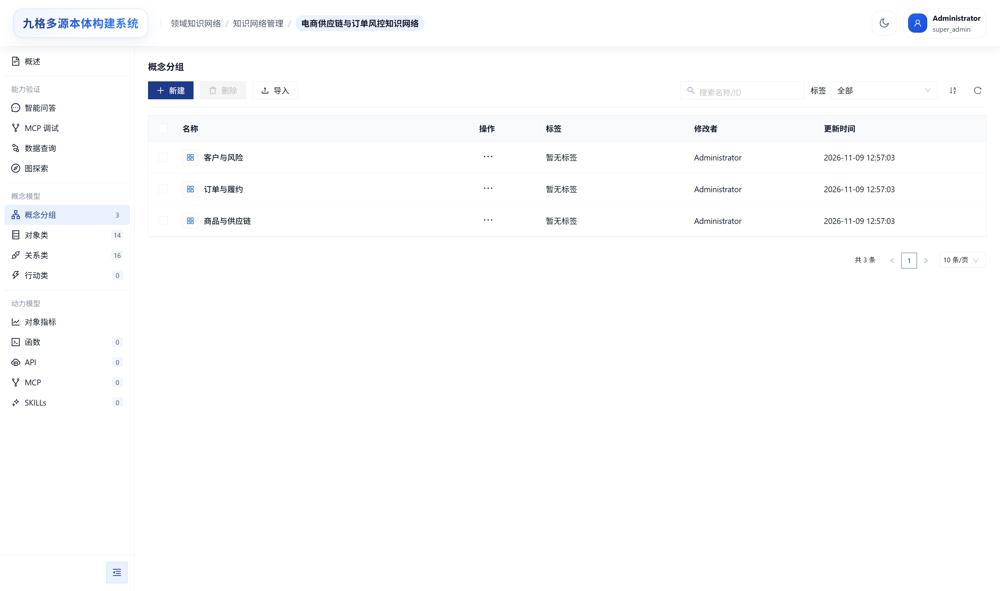

**概念分组**用于把对象类按业务板块归类，类似给文件夹分组。

页面字段：

| 字段 | 说明 |
| --- | --- |
| **名称** | 分组名称，建议使用业务人员一看就懂的名字 |
| **操作** | 行末省略按钮，可编辑或删除 |
| **标签** | 分组标签，便于筛选 |
| **修改者** | 最近一次修改的人 |
| **更新时间** | 最近一次修改的时间 |

示例中的三个分组：

- **客户与风险**：客户、收货地址、风控事件等。
- **订单与履约**：订单、订单明细、支付记录、物流单等。
- **商品与供应链**：商品、商品分类、库存、供应商、仓库等。

操作建议：

1. 新建分组时，名称直接用业务部门的通用叫法，不要使用缩写。
2. 一个对象类通常只归入一个最主要的分组，避免重复归类。
3. 删除分组前，先确认组内对象已经迁移到其他分组，避免对象"无家可归"。

### 3.5 对象类

对象类是知识网络的核心，代表业务中的"名词"。

进入方式：知识网络工作台左侧点击 **对象类**。

对象类页面有两种查看方式：

- **图谱**：以选中对象为中心，显示它和哪些对象、通过什么关系相连。
- **列表**：以表格方式列出全部对象类，适合查找和批量浏览。

#### 3.5.1 图谱视图

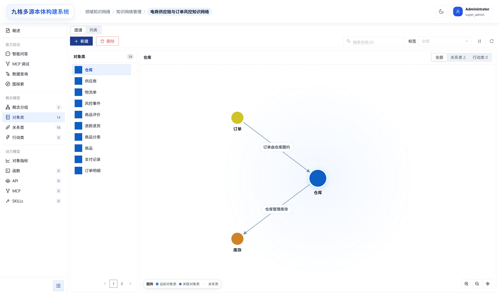

图谱视图的读法：

1. 左侧列表选择要查看的对象，例如"仓库"。
2. 中间画布以"仓库"为中心。
3. **蓝色节点**是当前对象类。
4. **其他颜色节点**是与它直接关联的对象类，例如"订单""库存"。
5. **连线上的文字**是关系类，例如"订单由仓库履约""仓库管理库存"。
6. 右上角可以切换"全部 / 关系类 / 行动类"。

图例位于画布底部：

| 图例 | 含义 |
| --- | --- |
| 当前对象类 | 当前选中的对象 |
| 关联对象类 | 与当前对象有直接关系的对象 |
| 关系类 | 两个对象之间的关系 |

> **业务用法**：当你想快速回答"仓库和哪些业务有关"时，图谱比列表更直观。点击关联节点可以继续向外探索。

#### 3.5.2 列表视图

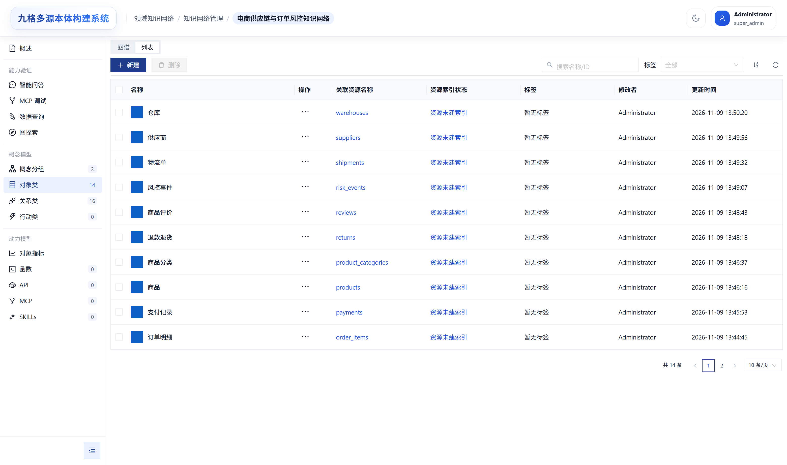

列表字段：

| 字段 | 说明 |
| --- | --- |
| **名称** | 对象类名称，例如"仓库""订单""商品" |
| **关联资源名称** | 该对象对应的数据表或数据资源 |
| **资源索引状态** | 数据是否已经可以用于检索，例如"资源未建索引" |
| **标签** | 对象标签，便于筛选 |
| **修改者 / 更新时间** | 最近修改信息 |

操作说明：

1. 使用搜索框按名称或 ID 查找对象。
2. 使用标签下拉框筛选。
3. 点击列标题可以排序（如按更新时间）。
4. 点击对象名称进入详情页。

#### 3.5.3 对象详情

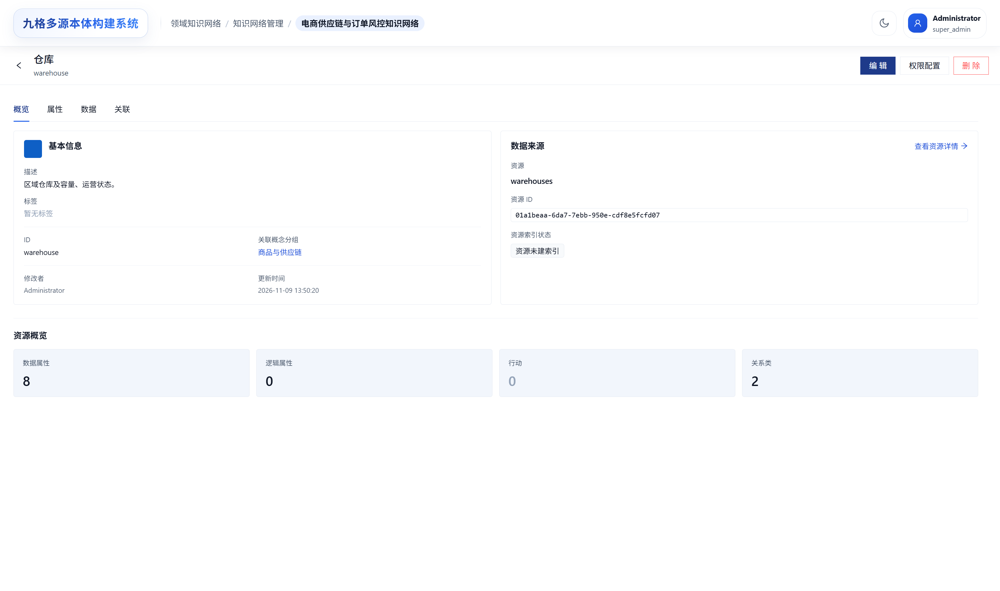

点击对象名称后进入详情页，顶部显示对象名称和英文 ID，下面有四个页签：

| 页签 | 作用 |
| --- | --- |
| **概览** | 查看描述、概念分组、数据来源、索引状态和各类属性数量 |
| **属性** | 查看对象的字段定义 |
| **数据** | 查看该对象对应的样例数据 |
| **关联** | 查看与该对象相连的关系类和行动类 |

概览页重点看三处：

1. **描述**：用一句业务语言说明这个对象是什么。例如"区域仓库及容量、运营状态"。
2. **关联概念分组**：这个对象属于哪个业务板块。
3. **资源索引状态**：数据是否已经可以用于问答和检索。

#### 3.5.4 属性

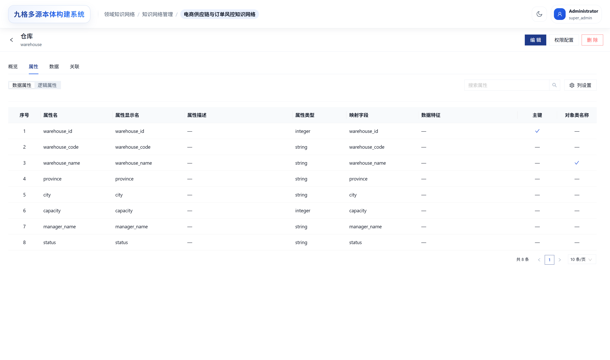

属性页分为**数据属性**和**逻辑属性**两种：

- **数据属性**：直接来自数据表的字段，例如仓库 ID、仓库名称、城市、容量。
- **逻辑属性**：由计算或规则得到的字段，例如"是否满仓"。

数据属性表格字段：

| 字段 | 说明 |
| --- | --- |
| **序号** | 属性排列顺序 |
| **属性名** | 英文技术名，例如 `warehouse_name` |
| **属性显示名** | 业务人员看到的名称 |
| **属性描述** | 对字段的业务解释 |
| **属性类型** | 数据类型，例如整数、文本、日期 |
| **映射字段** | 对应数据表中的字段名 |
| **主键** | 是否用于唯一标识一条记录，打勾表示是 |

> **业务用法**：如果业务同事反馈"问答答错了"，优先检查两处：属性的**显示名和描述**是否写得清楚，以及**主键**是否设置正确。主键相当于一条记录的"身份证号"，设置错误会导致数据串行。

#### 3.5.5 数据与关联

- **数据页签**：查看这个对象对应的真实数据样例，用来确认字段含义是否符合业务预期。
- **关联页签**：查看与这个对象相关的所有关系类。例如"仓库"关联"订单""库存"等对象。

### 3.6 关系类

关系类代表业务对象之间的"动词"。

进入方式：知识网络工作台左侧点击 **关系类**。

#### 3.6.1 关系类列表

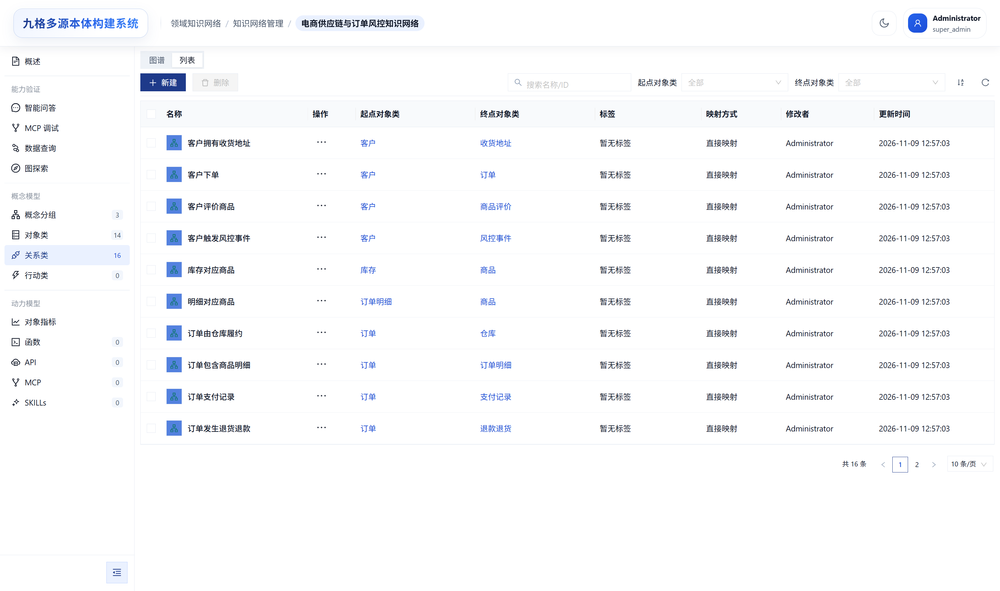

列表字段：

| 字段 | 说明 |
| --- | --- |
| **名称** | 关系名称，建议写成"主语 + 动词 + 宾语"的形式 |
| **起点对象类** | 关系的起点，例如"客户" |
| **终点对象类** | 关系的终点，例如"订单" |
| **标签** | 关系标签 |
| **映射方式** | 关系如何从数据中产生，例如"直接映射" |
| **修改者 / 更新时间** | 最近修改信息 |

读法示例：

- **客户下单**：起点是"客户"，终点是"订单"，表示客户提交并拥有订单。
- **订单由仓库履约**：起点是"订单"，终点是"仓库"，表示订单由某个仓库发货。
- **订单包含商品明细**：起点是"订单"，终点是"订单明细"。

> **方向很重要**：起点和终点写反，会让问答把因果关系说反。例如"客户下单"不能写成"订单下单客户"。如果发现方向不对，请联系维护人员调整。

#### 3.6.2 关系类详情

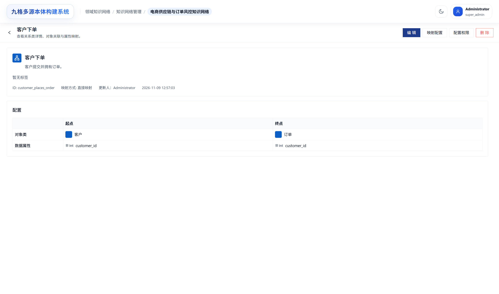

详情页显示：

1. **关系名称和描述**：用业务语言说明这两个对象为什么相关。
2. **映射方式**：目前示例中为"直接映射"，表示关系直接来自数据表之间的关联。
3. **配置表**：分为"起点"和"终点"两列，列出两边对象用于关联的数据属性。例如客户和订单都使用 `customer_id` 关联。

业务人员主要关注：

- 描述是否说清楚了业务含义。
- 起点和终点是否符合业务常识。
- 关联使用的字段是否两边含义一致。

### 3.7 行动类

行动类表示"业务上可以执行的动作"，例如发起退款审核、冻结风险账户。它把"什么时候触发、对哪个业务对象执行、执行后影响什么"描述清楚，是知识网络从"看懂业务"走向"处理业务"的关键。

进入方式：知识网络工作台左侧点击 **行动类**。页面支持图谱和列表两种视图，列表视图会显示每个行动类的名称、业务动作、绑定对象类、修改者和更新时间。

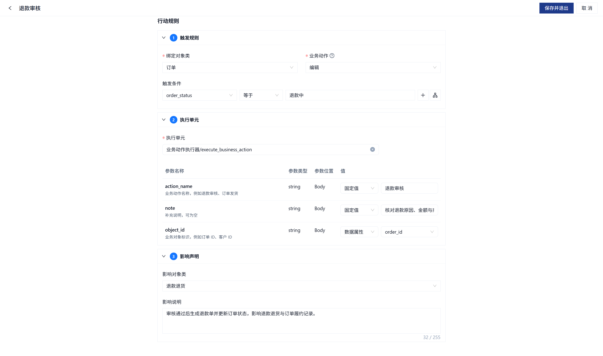

当前示例知识网络已配置 1 个行动类，配置如下：

| 配置项 | 内容 |
| --- | --- |
| 行动类名称 | 退款审核 |
| ID | `refund_review` |
| 绑定对象类 | 订单 |
| 业务动作 | 编辑 |
| 触发条件 | `order_status` 等于"退款中" |
| 执行单元 | 业务动作执行器 / `execute_business_action` |
| 参数映射 | `action_name` 固定为"退款审核"；`note` 固定为"核对退款原因、金额与商品明细"；`object_id` 取订单的 `order_id` 属性 |
| 影响对象类 | 退款退货 |
| 影响说明 | 审核通过后生成退款单并更新订单状态，影响退款退货与订单履约记录 |

#### 3.7.1 新增行动类的步骤

1. 在行动类页面点击 **新建**。
2. 填写**行动类名称**、**ID** 和**描述**。描述要写清楚触发时机和处理内容。
3. 展开**触发规则**，选择**绑定对象类**（例如订单）和**业务动作**（添加、编辑、删除）。
4. 按需设置**触发条件**，例如"订单状态等于退款中"。
5. 展开**执行单元**，选择已发布的工具，并把工具参数映射为固定值或对象属性。
6. 展开**影响声明**，选择影响对象类并填写影响说明。
7. 点击右上角**保存并退出**。

> **注意**：执行单元是必填项。如果工具列表为空，需要先在"执行工厂 → 执行单元"中创建并发布工具，否则行动类无法保存。

#### 3.7.2 业务人员需要确认什么

行动类的技术配置通常由技术同事完成，业务人员主要确认以下三点：

1. **触发条件是否符合业务规则**：什么情况下应该执行这个动作。
2. **业务动作是否准确**：是新增、修改还是删除业务对象。
3. **影响说明是否完整**：执行后会改变哪些业务对象，是否需要人工复核。

确认无误后，可在详情页点击 **执行管理** 查看执行记录，或点击 **编辑** 调整配置。

### 3.8 能力验证：智能问答

智能问答用于验证知识网络是否"听得懂、答得准"。

进入方式：知识网络工作台左侧 **智能问答**。

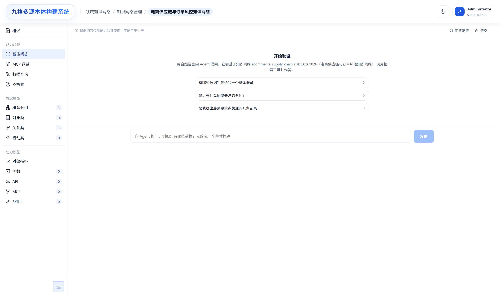

操作步骤：

1. 在页面底部的输入框中输入业务问题，例如"有哪些数据？先给我一个整体概览"。
2. 点击**发送**，或按回车键。
3. 等待 Agent 返回结果。
4. 根据回答是否准确，判断知识网络和数据是否配置正确。

页面上的三个快捷问题可以直接点击使用：

- 有哪些数据？先给我一个整体概览
- 最近有什么值得关注的变化？
- 帮我找出最需要重点关注的几条记录

> **重要提示**：页面顶部明确标注"智能问答仅供能力验证使用，不能用于生产"。它适合验证知识网络，不适合直接作为对外客服或生产系统使用。

如果提问后出现下面的提示：

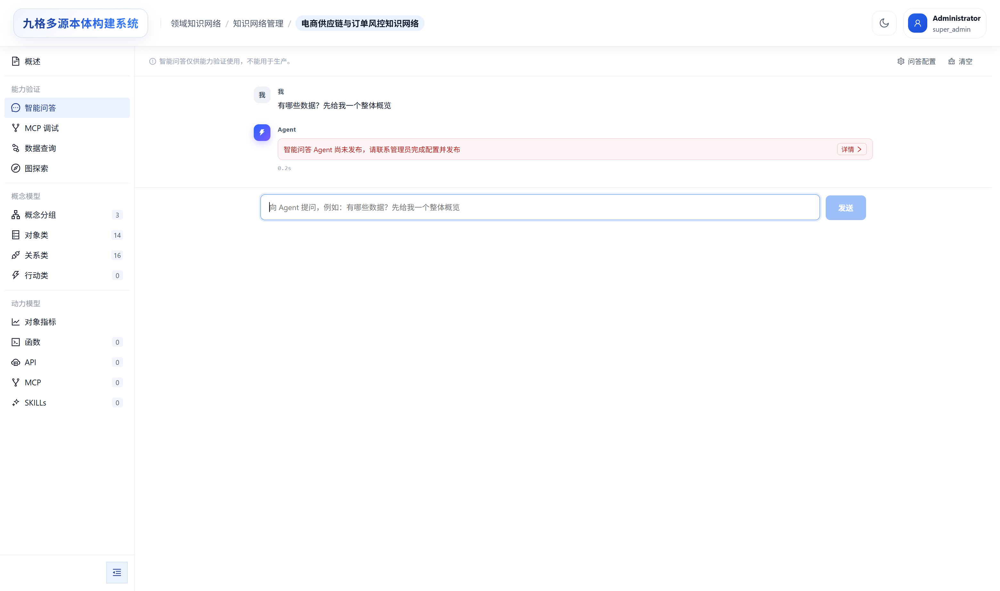

说明**智能问答 Agent 还没有发布**。这时需要：

1. 确认模型管理中已经配置可用的大模型。
2. 联系管理员完成问答 Agent 的配置和发布。
3. 发布后重新提问验证。

### 3.9 图探索

图探索用于以图形方式浏览实体和它们之间的关系，适合做"顺着关系找线索"的分析。

使用前提：

1. 对象类已经绑定数据资源。
2. 数据资源已经完成索引构建。

如果数据索引尚未完成，点击图探索可能看不到内容。请先到 **数据资源知识网络 → 数据目录** 检查索引状态，或让管理员完成索引构建。

### 3.10 动力模型的业务视角

"动力模型"让知识网络不仅能"看懂数据"，还能"计算指标"和"执行能力"。

| 菜单 | 业务人员怎么理解 | 建议 |
| --- | --- | --- |
| **对象指标** | 业务指标，例如客单价、退款率、库存周转天数 | 业务人员重点参与指标口径的定义和确认 |
| **函数** | 计算逻辑 | 由技术同事维护 |
| **API** | 调用外部系统的能力 | 由技术同事维护 |
| **MCP** | 供智能体调用的工具入口 | 由技术同事维护 |
| **SKILLs** | 封装好的技能 | 由技术同事维护 |

当前示例知识网络已接入 1 个函数型执行单元"业务动作执行器"，用于承载行动类的执行；API、MCP 和 SKILLs 数量仍为 0。这不影响查看对象、关系和问答验证。

### 3.11 知识网络对接

进入方式：左侧菜单 **领域知识网络 → 知识网络对接**。

这个页面的作用是把知识网络的能力开放给智能体平台或业务系统，提供统一的调用入口。页面包含三种接入方式：

- **MCP 对接**：供智能体平台调用。
- **CLI 对接**：供终端和 Agent 使用。
- **SDK 对接**：供服务端程序集成。

> **业务人员需要知道的**：这一页主要面向技术同事。业务人员只需了解"知识网络可以被智能体调用"，具体的 API Key、配置文件和接入地址由 IT 或管理员操作，请不要自行复制或外传密钥。

---

## 4. 数据资源知识网络

### 4.1 它解决什么问题

知识网络里的对象和关系，最终都要落到真实数据上。数据资源知识网络负责：

1. 把企业数据库接入系统（**数据连接**）。
2. 把数据库里的表整理成可管理的资源（**数据目录**）。
3. 对资源进行探查、预览、索引和语义理解（**资源详情**）。
4. 跟踪这些任务的执行情况（**任务管理**）。

可以把它理解成"知识网络的后厨"：前端看到的是业务对象，后厨准备的是真实数据。

### 4.2 数据连接

进入方式：左侧菜单 **数据资源知识网络 → 数据连接**。

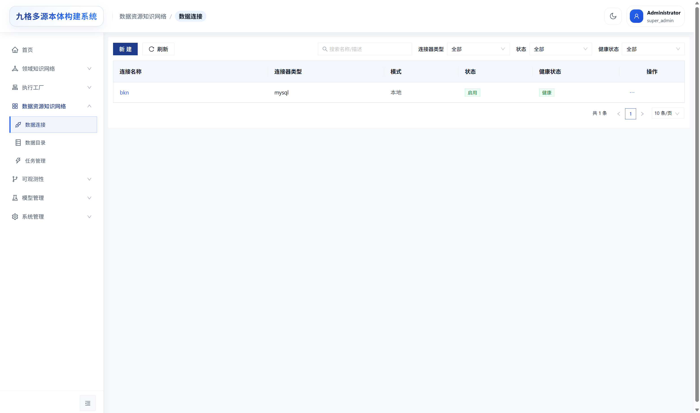

页面字段：

| 字段 | 说明 |
| --- | --- |
| **连接名称** | 数据连接的名称，例如示例中的 `bkn` |
| **连接器类型** | 数据源类型，例如 MySQL |
| **模式** | 连接方式，例如"本地" |
| **状态** | 连接是否启用 |
| **健康状态** | 系统当前能否正常访问数据源 |

操作说明：

1. 使用搜索框按名称或描述查找连接。
2. 可以按连接器类型、状态、健康状态筛选。
3. 点击连接名称可以查看连接详情和最近一次健康检查结果。
4. 点击**刷新**重新加载列表。

> **注意**：健康状态显示"健康"，只说明系统能够访问数据库，**不代表数据已经完成探查或索引**。数据能不能被知识网络使用，还要看数据目录中的资源状态和索引状态。

创建数据连接需要填写数据库地址、端口、账号等技术信息，属于管理员或技术同事的工作。业务人员通常只需**确认连接名称是否好识别、数据范围是否正确**。

### 4.3 数据目录

进入方式：左侧菜单 **数据资源知识网络 → 数据目录**。

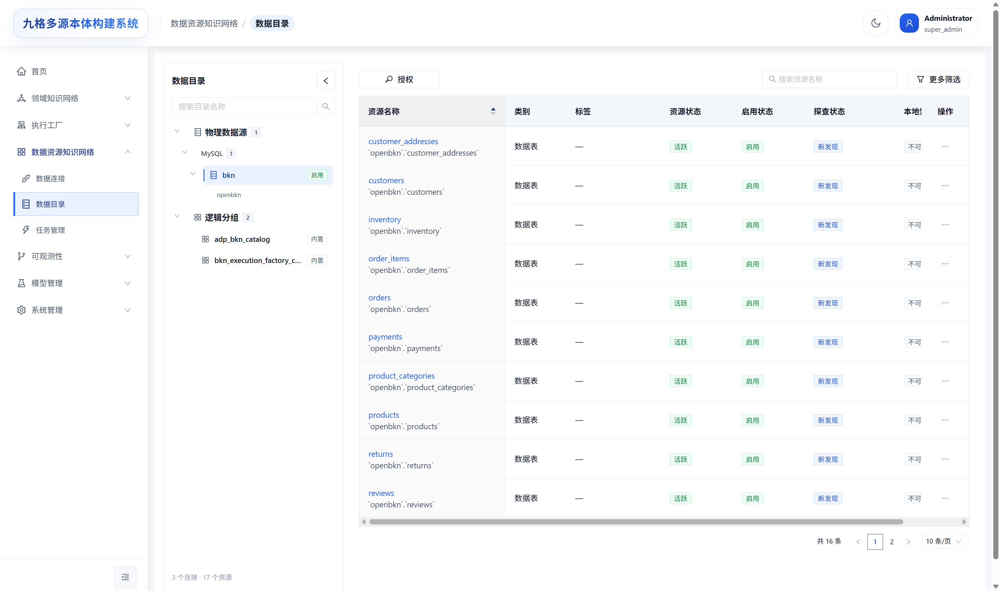

页面分为左右两部分。

#### 左侧：数据资源树

- **物理数据源**：按连接器类型分组，例如 MySQL，下面挂具体的连接。
- **逻辑分组**：系统内置的目录，例如 `adp_bkn_catalog`、`bkn_execution_factory_catalog`。

操作步骤：

1. 先展开"物理数据源"。
2. 展开对应的连接器类型，例如"MySQL"。
3. 点击具体连接，例如 `bkn`。
4. 右侧显示该连接下的资源列表。

#### 右侧：资源列表

列表字段：

| 字段 | 说明 |
| --- | --- |
| **资源名称** | 数据表名称，例如 `customers`、`orders`、`products` |
| **类别** | 资源类型，例如"数据表" |
| **标签** | 自定义标签 |
| **资源状态** | 资源当前是否活跃 |
| **启用状态** | 是否允许系统使用该资源 |
| **探查状态** | 系统是否已经识别资源的结构 |
| **本地索引状态** | 是否已经建立检索索引 |

常见状态含义：

| 状态 | 含义 | 业务影响 |
| --- | --- | --- |
| 活跃 | 资源可以正常访问 | 可以继续使用 |
| 启用 | 资源已开放给系统使用 | 知识网络可以引用 |
| 新发现 | 系统刚发现该资源，尚未深入探查 | 建议发起探查 |
| 不可用（索引） | 尚未建立索引 | 问答和图探索可能查不到 |

操作说明：

- 使用**搜索资源名称**快速定位表。
- 使用**更多筛选**按类别、状态等条件筛选。
- 点击资源名称进入资源详情。
- 点击行末省略按钮，可以发起探查、查看任务等。

### 4.4 数据资源详情

点击资源名称后进入资源详情页。

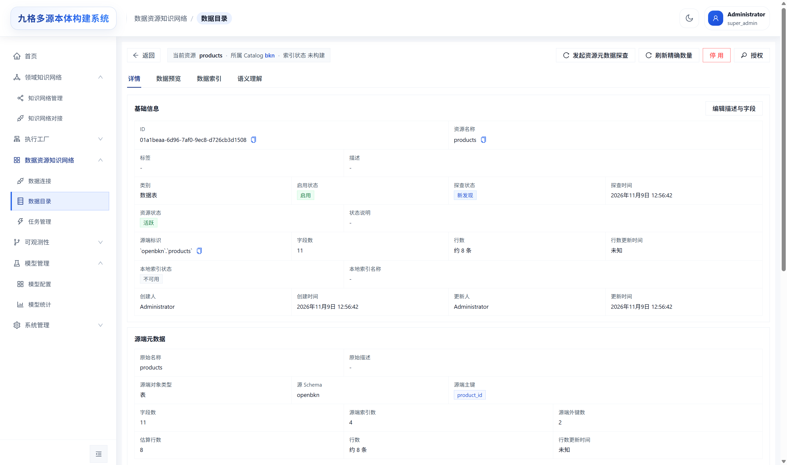

页面顶部显示当前资源名称、所属连接和索引状态，并提供几个常用按钮：

| 按钮 | 作用 |
| --- | --- |
| **发起资源元数据探查** | 让系统重新识别表结构、字段和行数 |
| **刷新精确数量** | 重新统计资源的准确行数 |
| **停用 / 启用** | 控制资源是否允许被使用 |
| **授权** | 给用户或角色分配资源权限 |

资源详情有四个页签：

#### 4.4.1 详情

展示资源的基础信息和业务含义，包括：

- 资源名称、描述、类别。
- 启用状态、探查状态、资源状态。
- 字段数、行数。
- 源端信息，例如来源表、主键、字段数量。

业务人员重点确认：**资源描述是否写清楚了这张表是做什么的**。描述越清楚，后续问答越准确。

#### 4.4.2 数据预览

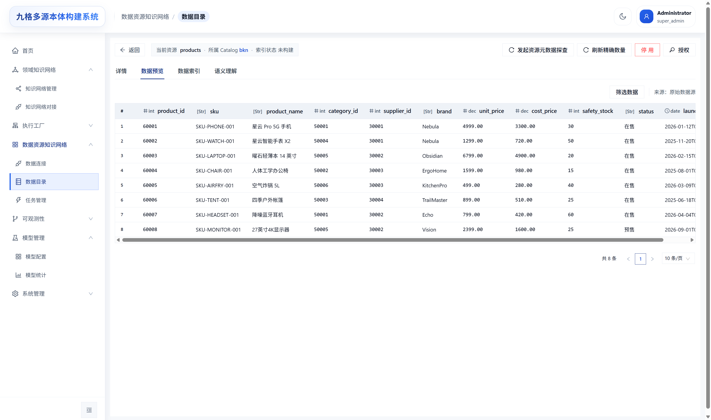

数据预览用于直接查看表里的样例数据：

1. 默认显示前若干行数据。
2. 拖动底部滚动条可以查看右侧更多字段。
3. 点击**筛选数据**可以按条件过滤。
4. 页面标注"来源：原始数据源"，表示这是直接读取的原始数据。

业务用法：当不确定某个字段的含义时，看几条真实数据往往比看字段名更直观。

#### 4.4.3 数据索引

数据索引用于让知识网络能够快速检索这张表的数据。

- 索引状态为"未构建"时，问答和图探索可能无法使用该资源。
- 构建索引通常需要管理员或技术同事操作。
- 索引构建可能需要一定时间，可以在"任务管理 → 索引构建任务"中查看进度。

#### 4.4.4 语义理解

语义理解用于让系统理解字段和表的业务含义，从而在问答时更准确地识别用户意图。

例如，字段名 `customer_level` 经过语义理解后，系统可以知道它表示"客户等级"，而不是普通的文本字段。

### 4.5 任务管理

进入方式：左侧菜单 **数据资源知识网络 → 任务管理**。

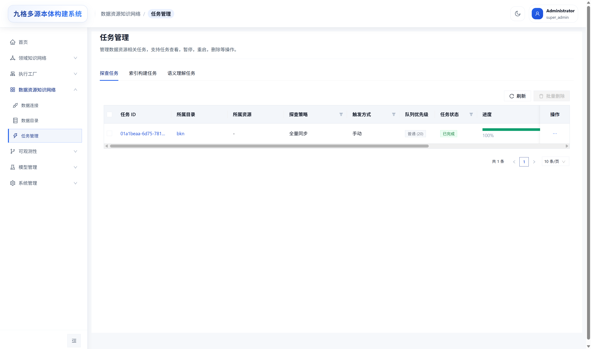

任务管理页面有三个页签：

| 页签 | 作用 |
| --- | --- |
| **探查任务** | 查看资源元数据探查的执行情况 |
| **索引构建任务** | 查看数据索引构建的执行情况 |
| **语义理解任务** | 查看语义理解的执行情况 |

列表字段：

| 字段 | 说明 |
| --- | --- |
| **任务 ID** | 任务的唯一编号 |
| **所属目录 / 所属资源** | 任务针对哪个连接或资源 |
| **探查策略** | 例如"全量同步" |
| **触发方式** | 例如"手动" |
| **队列优先级** | 任务排队优先级，例如"普通" |
| **任务状态** | 例如"已完成" |
| **进度** | 完成百分比 |
| **进度更新时间** | 最近一次进度变化时间 |

操作说明：

1. 点击**刷新**查看最新进度。
2. 勾选任务后可以**批量删除**。
3. 点击行末省略按钮可以查看详情、暂停或重启任务。

> **建议**：索引构建或探查任务执行期间，不要重复发起相同任务。先刷新查看进度，避免任务排队。

### 4.6 从数据到知识的推荐流程

把数据接入知识网络，建议按下面的顺序进行：

```
1. 管理员建立数据连接
        ↓
2. 在数据目录中发起资源探查，确认表结构
        ↓
3. 启用需要使用的资源
        ↓
4. 构建数据索引
        ↓
5. 在知识网络中把对象类绑定到资源
        ↓
6. 在智能问答中验证结果
```

每一步都可以在任务管理中查看执行情况。如果第 6 步问答结果不准确，优先回到第 2 步检查字段描述和主键，再检查第 4 步索引是否完成。

---

## 5. 模型管理

### 5.1 大模型与小模型

进入方式：左侧菜单 **模型管理 → 模型配置**。

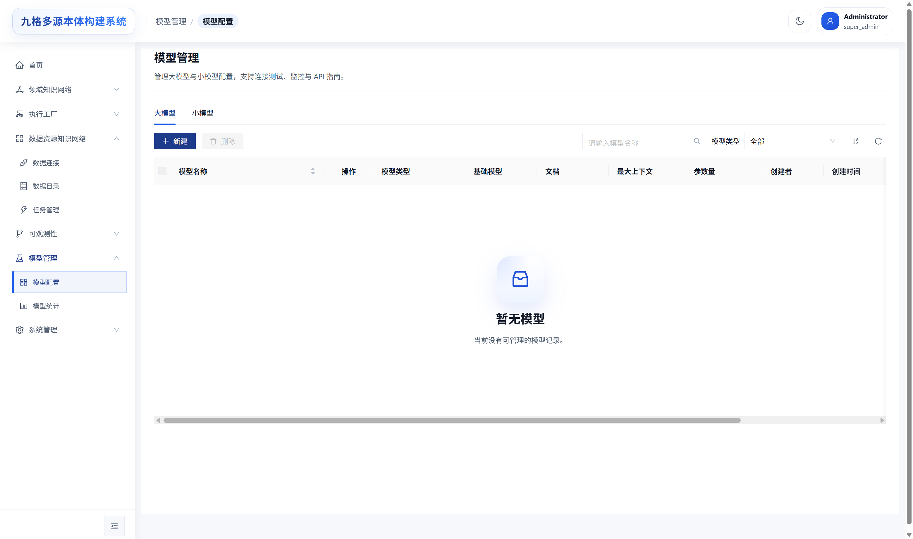

页面顶部有两个页签：

| 类型 | 主要用途 | 业务人员怎么理解 |
| --- | --- | --- |
| **大模型** | 自然语言理解、生成、问答 | 负责"听懂问题、组织答案" |
| **小模型** | 向量化、分类等专用任务 | 负责"把文字变成可检索的向量"等专项工作 |

当前演示环境还没有配置任何模型，所以列表显示"暂无模型"。

### 5.2 模型配置

#### 5.2.1 列表字段

| 字段 | 说明 |
| --- | --- |
| **模型名称** | 便于识别的名称，例如"业务问答主模型" |
| **模型类型** | 例如大语言模型（LLM） |
| **基础模型** | 使用的模型系列 |
| **文档** | 模型说明文档入口 |
| **最大上下文** | 一次能处理的内容长度 |
| **参数量** | 模型规模 |
| **创建者 / 创建时间** | 模型记录的创建信息 |

#### 5.2.2 新建模型

点击页面左上角的 **新建**。

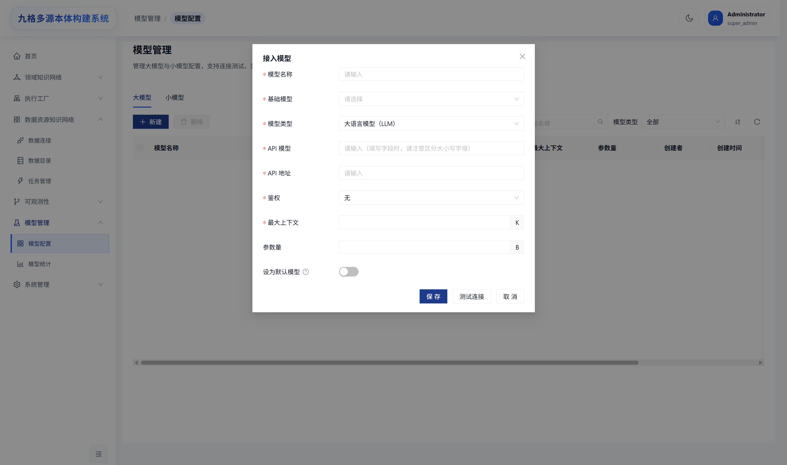

弹窗字段说明：

| 字段 | 业务含义 | 谁来填写 |
| --- | --- | --- |
| **模型名称** | 给这个模型起一个业务上容易识别的名字 | 业务或管理员 |
| **基础模型** | 选择要接入的模型系列 | 管理员 |
| **模型类型** | 一般为"大语言模型（LLM）" | 管理员 |
| **API 模型** | 模型服务提供的模型标识 | 管理员 / 技术同事 |
| **API 地址** | 模型服务的访问地址 | 管理员 / 技术同事 |
| **鉴权** | 调用模型服务时的身份验证方式 | 管理员 / 技术同事 |
| **最大上下文** | 一次能处理的内容长度，单位 K | 管理员 |
| **参数量** | 模型规模，单位 B | 管理员 |
| **设为默认模型** | 开启后，新场景默认使用该模型 | 业务负责人确认 |

操作步骤：

1. 填写**模型名称**，建议包含用途，例如"业务问答主模型"。
2. 选择**基础模型**和**模型类型**。
3. 由管理员填写 API 模型、API 地址和鉴权信息。
4. 填写**最大上下文**和**参数量**。
5. 点击**测试连接**，确认系统能够访问模型服务。
6. 测试通过后点击**保存**。
7. 如需作为默认模型，打开"设为默认模型"开关后再保存。

> **安全提示**：API 地址和鉴权信息属于敏感配置，不要截图、不要粘贴到聊天工具或普通文档中。业务人员通常只需确认模型名称和用途，具体配置交给管理员。

#### 5.2.3 修改与删除

- 点击模型行末的操作按钮，可以编辑或删除模型。
- 删除前请确认没有知识网络或 Agent 正在使用该模型。
- 修改默认模型可能影响所有问答场景，建议在业务低峰期操作。

### 5.3 模型统计

进入方式：左侧菜单 **模型管理 → 模型统计**。

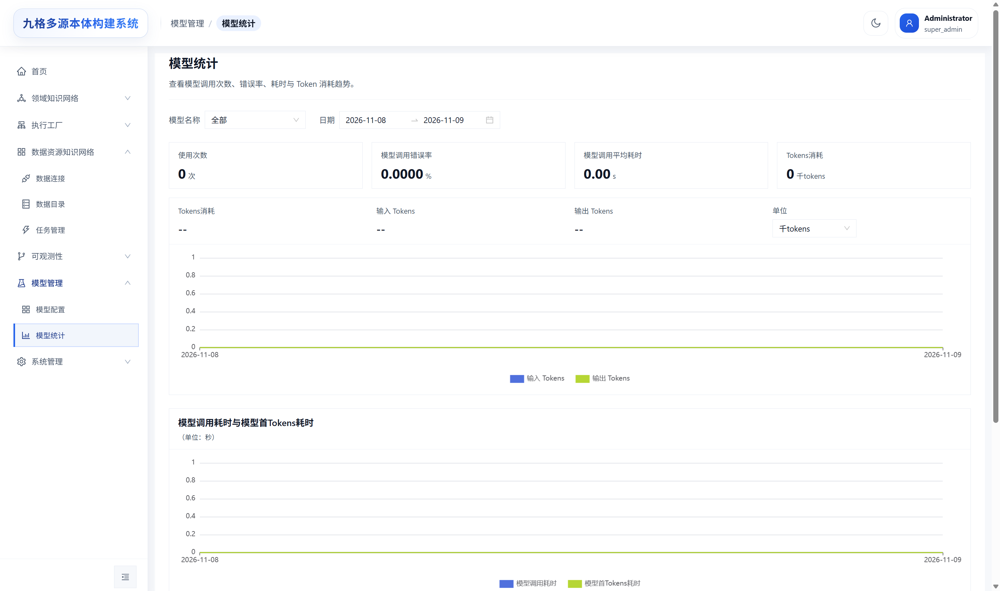

页面用于查看模型的使用情况和稳定性。

#### 5.3.1 筛选条件

| 条件 | 说明 |
| --- | --- |
| **模型名称** | 选择要查看的模型，默认"全部" |
| **日期** | 选择统计的时间范围 |

#### 5.3.2 四个核心指标

| 指标 | 含义 | 业务解读 |
| --- | --- | --- |
| **使用次数** | 该时间段内模型被调用的次数 | 反映使用活跃度 |
| **模型调用错误率** | 调用失败的比例 | 越高说明越不稳定 |
| **模型调用平均耗时** | 每次调用平均需要多少秒 | 影响问答等待时间 |
| **Tokens 消耗** | 消耗的 Token 数量 | 直接影响模型使用成本 |

下方图表展示：

- **Tokens 消耗趋势**：输入 Tokens、输出 Tokens 的变化。
- **模型调用耗时与首 Tokens 耗时**：响应速度的变化趋势。

业务用法：

1. 如果**错误率明显升高**，先检查模型服务是否可用，再联系管理员。
2. 如果**平均耗时变长**，可能是模型负载高或网络不稳定。
3. 如果**Tokens 消耗增长很快**，需要关注使用场景是否合理，例如是否存在重复提问或超长输入。

> **提示**：演示环境中还没有配置模型，所以统计数据全部为 0，属于正常现象。

### 5.4 模型与知识网络的关系

智能问答要正常工作，需要三个条件同时满足：

1. **知识网络已经建好**：有对象类、关系类，并且绑定了数据资源。
2. **数据已经建索引**：问答能够检索到真实数据。
3. **模型和 Agent 已经配置并发布**：模型提供理解与生成能力，Agent 负责调用工具。

三者缺一，智能问答就可能出现"Agent 尚未发布""查不到数据"或"答非所问"。

---

## 6. 执行工厂

### 6.1 执行工厂是做什么的

知识网络里的行动类，以及对象类中的工具型逻辑属性，最终都需要"真正执行"的能力。执行工厂就是这些能力的仓库。

进入方式：左侧菜单 **执行工厂**。它包含两个子菜单：

| 菜单 | 作用 |
| --- | --- |
| **执行单元** | 管理可被调用的工具，分为 API 工具集、函数集、MCP 服务、SKILL 包四类 |
| **沙箱运行时管理** | 查看函数执行环境的健康状态、会话池和运行任务 |

业务人员通常只需要了解执行单元的用途，以及行动类绑定了哪个工具；具体创建和调试由技术同事完成。

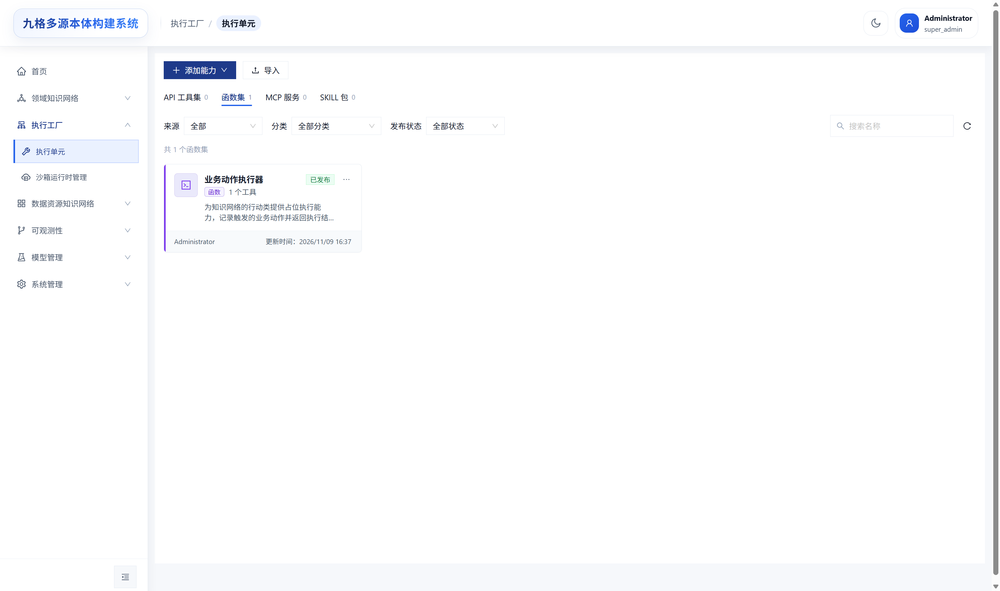

### 6.2 执行单元的四种类型

执行单元页面有四个页签，对应四种工具类型：

| 类型 | 说明 | 适合场景 | 业务人员关注点 |
| --- | --- | --- | --- |
| **API 工具集** | 接入已有的 HTTP 接口，声明输入和输出 | 业务系统已经提供退款、下单、查询等接口 | 接口用途、参数含义、授权范围 |
| **函数集** | 在线编写 Python 函数，在沙箱中运行 | 轻量计算、数据加工、流程编排、占位验证 | 输入输出、依赖、失败处理 |
| **MCP 服务** | 通过 SSE 或 Streamable HTTP 连接 MCP Server | 复用已有的 MCP 工具生态 | 服务地址、鉴权、网络连通性 |
| **SKILL 包** | 上传 SKILL 压缩包或 Markdown 内容 | 把提示词、工具调用和流程打包复用 | 适用范围、版本、权限 |

点击页面左上角 **添加能力**，可以看到对应的四种创建入口：

- 添加 HTTP API
- 新建代码函数
- 注册 MCP 服务
- 导入 SKILL

### 6.3 函数集示例：业务动作执行器

演示环境原本没有任何执行单元，而行动类保存时必须选择一个执行单元。因此创建了函数集 **业务动作执行器**，作为行动类的占位执行能力。

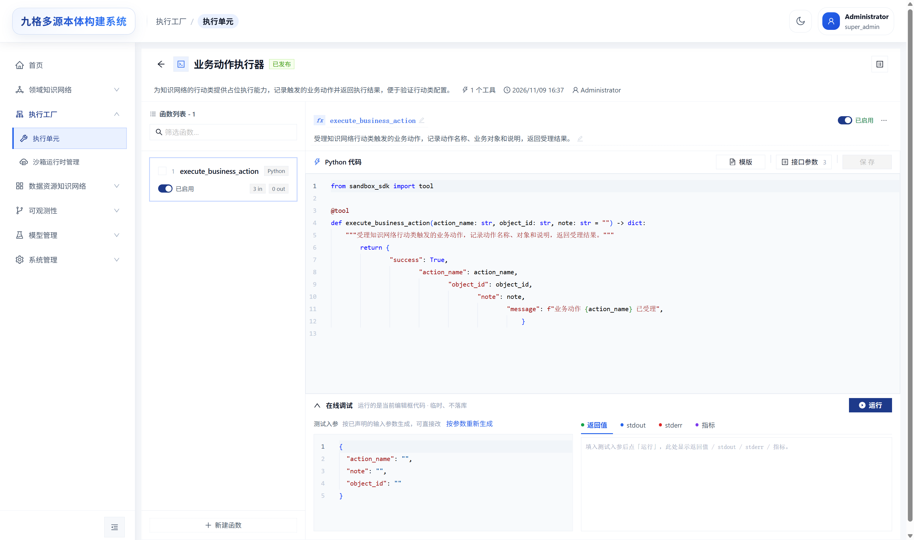

#### 6.3.1 创建步骤

1. 进入 **执行工厂 → 执行单元**，点击 **添加能力 → 新建代码函数**。
2. 填写工具箱名称"业务动作执行器"、描述和分类，点击 **确定**。
3. 在函数列表中选中默认函数，填写函数名和函数描述。
4. 在 Python 代码区编写函数实现。
5. 点击 **接口参数**，声明输入参数的名称、类型、是否必填和说明。
6. 点击 **保存**。
7. 返回执行单元列表，点击函数集卡片右上角的省略按钮，选择 **发布**。
8. 发布成功后可点击 **去配置权限**，限制可调用的人员范围。

#### 6.3.2 函数代码

```python
from sandbox_sdk import tool


@tool
def execute_business_action(action_name: str, object_id: str, note: str = "") -> dict:
    """受理知识网络行动类触发的业务动作，记录动作名称、对象和说明，返回受理结果。"""
    return {
        "success": True,
        "action_name": action_name,
        "object_id": object_id,
        "note": note,
        "message": f"业务动作 {action_name} 已受理",
    }
```

#### 6.3.3 接口参数

| 参数名 | 类型 | 必填 | 说明 |
| --- | --- | --- | --- |
| `action_name` | string | 是 | 业务动作名称，例如退款审核、订单发货 |
| `object_id` | string | 是 | 业务对象标识，例如订单 ID、客户 ID |
| `note` | string | 否 | 补充说明，可为空 |

保存后，函数列表会显示 `3 in / 0 out`，表示声明了 3 个输入参数、没有输出参数。

#### 6.3.4 这个函数实际做什么

- 它只记录并返回"业务动作已受理"，**不会修改订单、退款或任何业务数据**。
- 它是占位执行器，用于验证"行动类 → 执行单元 → 参数映射"这条链路是否打通。
- 它已经被"退款审核"行动类引用，参数映射为：`action_name` 固定值、`note` 固定值、`object_id` 取订单的 `order_id` 属性。

> **提示**：接口参数必须与代码中的函数签名保持一致。系统不会强制校验，参数对不上时执行会失败。修改已发布的函数并保存后，页面会提示"保存后立即生效"。

### 6.4 API 工具集（说明）

API 工具集用于把已有的 HTTP 接口接入系统，支持粘贴 cURL 或填写单个接口信息。

- 适合业务系统已经提供标准接口的场景，例如退款申请、订单查询、库存同步。
- 接入时需要声明输入参数和输出结构，发布后才能被行动类或逻辑属性调用。
- 业务人员主要确认接口的**业务用途、参数含义和授权范围**；接口地址、鉴权方式、超时和重试由技术同事配置。
- 使用前应确认接口是幂等的，避免重复执行造成重复退款或重复下单。

### 6.5 MCP 服务（说明）

MCP 服务用于连接外部的 MCP Server，把远端工具注册为执行单元。

- 支持 SSE 和 Streamable HTTP 两种连接方式。
- 适合复用已有的 MCP 工具生态，例如外部风控、工单、知识库服务。
- 业务人员主要确认**服务的作用和可执行的动作范围**；服务地址、鉴权、网络连通性由技术同事维护。
- 远端服务不可用时会记录执行失败，需要在执行管理中查看错误信息。

### 6.6 SKILL 包（说明）

SKILL 包用于把一组技能封装后上传，支持上传压缩包或粘贴 Markdown 内容。

- 适合把提示词、工具调用步骤和业务流程打包复用。
- 业务人员主要确认**技能的适用范围、版本和权限**。
- SKILL 包通常与智能体配合使用，不等同于单个函数或接口。

### 6.7 沙箱运行时管理

进入方式：左侧菜单 **执行工厂 → 沙箱运行时管理**。

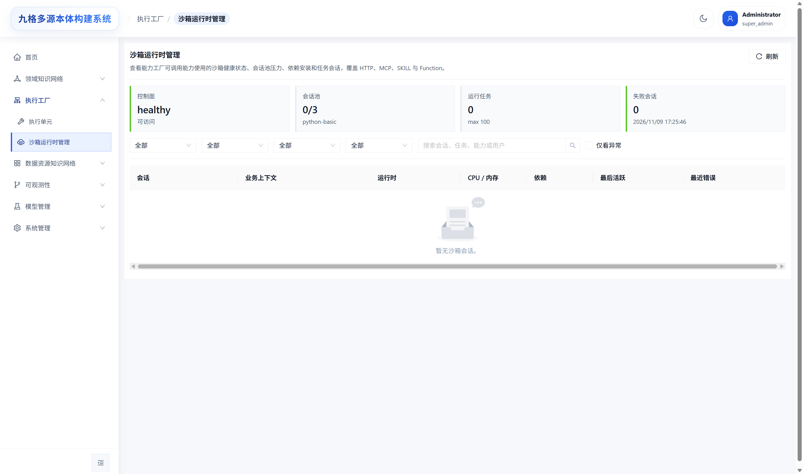

页面用于查看函数执行环境的状态：

| 指标 | 含义 |
| --- | --- |
| **控制面** | 沙箱管理服务是否正常 |
| **会话池** | 当前已用会话数与上限 |
| **运行任务** | 正在执行的任务数量 |
| **失败会话** | 最近失败的数量和时间 |

函数在沙箱中运行，不会直接操作生产数据库。业务人员一般不需要操作这个页面；如果发现控制面异常、失败会话持续增加或运行任务堆积，应联系管理员处理。

### 6.8 发布、权限与变更

1. **未发布的工具集不会出现在行动类的工具列表中。** 创建完成后必须执行"发布"。
2. **修改已发布的工具集并保存后立即生效**，页面会明确提示。建议先在演示环境验证。
3. **发布后配置权限**，只授权真正需要调用的人员或角色。
4. **停用或删除工具集前**，先确认没有行动类或逻辑属性正在引用。
5. **接口参数和代码保持一致**，参数缺失或类型不符会导致执行失败。
6. **高风险动作**（退款、冻结、删除）建议在业务系统中保留人工复核。

### 6.9 执行工厂常见问题

| 问题 | 原因与处理 |
| --- | --- |
| 行动类的"执行单元"列表为空 | 没有已发布的工具集。先到执行单元发布工具 |
| 保存行动类提示"请选择执行单元" | 执行单元是必填项，先选择工具并完成参数映射 |
| 函数"接口参数"显示为 0 | 需要在接口参数面板中手工声明；"反推参数"依赖模型能力，模型未配置时可能失败 |
| 修改函数后行动类没有变化 | 确认已点击保存，并在提示框中确认"保存后立即生效" |
| 函数执行失败 | 查看沙箱运行时管理的失败会话，以及行动类的执行管理日志 |
| 工具集发布后仍选不到 | 检查发布状态、权限和分类筛选条件 |

---

## 7. 常见问题

### Q1：登录后看不到某些菜单

**原因**：当前账号没有对应功能的权限。

**处理**：联系管理员在"系统管理 → 用户管理 / 角色管理"中分配权限。不要使用他人的账号登录。

### Q2：智能问答提示"Agent 尚未发布"

**原因**：问答 Agent 还没有完成配置或发布。

**处理**：

1. 到"模型管理 → 模型配置"确认已有可用的大模型。
2. 联系管理员完成 Agent 配置并发布。
3. 发布后重新提问验证。

### Q3：对象类显示"资源未建索引"

**原因**：对象类对应的数据资源还没有建立索引。

**处理**：到"数据资源知识网络 → 数据目录"找到对应资源，查看索引状态；由管理员构建索引后，再回到知识网络查看。

### Q4：数据连接显示"健康"，但数据目录里看不到表

可能原因：

1. 连接使用的数据库账号没有读取这些表的权限。
2. 数据目录还没有执行探查。
3. 资源被停用或未启用。

**处理**：先点击资源列表的刷新；仍看不到时，联系管理员检查数据库权限和探查任务。

### Q5：任务一直显示"进行中"

**原因**：任务可能在实际执行、排队，或者已经卡住。

**处理**：

1. 点击刷新查看进度更新时间。
2. 如果长时间没有变化，联系管理员查看任务详情。
3. 不要重复发起相同任务，避免队列堆积。

### Q6：模型统计里的数据都是 0

**原因**：当前环境还没有配置模型，或所选时间范围内没有调用记录。

**处理**：先确认"模型配置"中已有模型，再调整日期范围重新查看。

### Q7：图表或页面显示为空

可能原因：

1. 数据索引尚未完成。
2. 当前筛选条件下没有数据。
3. 账号没有对应资源的查看权限。

**处理**：依次检查筛选条件、索引状态和权限。

### Q8：修改知识网络后多久生效

- 对象类、关系类、概念分组的修改通常保存后立即生效。
- 数据索引和语义理解需要重新构建，生效时间取决于任务执行情况。
- 涉及模型或 Agent 的修改，需要发布后才会在问答中生效。

---

## 8. 状态速查表

| 状态 | 出现位置 | 含义 | 建议动作 |
| --- | --- | --- | --- |
| **健康** | 数据连接 | 系统能访问数据源 | 可继续查看资源 |
| **异常** | 数据连接 | 系统无法访问数据源 | 联系管理员检查网络和账号 |
| **启用** | 数据连接 / 资源 | 允许系统使用 | 无需操作 |
| **停用** | 数据连接 / 资源 | 系统不使用该连接或资源 | 确认是否仍需要 |
| **新发现** | 资源列表 | 系统刚发现资源，尚未深入探查 | 发起资源元数据探查 |
| **活跃** | 资源列表 | 资源可以正常访问 | 可继续使用 |
| **不可用（索引）** | 资源列表 / 对象类 | 尚未建立索引 | 构建数据索引 |
| **已完成** | 任务管理 | 任务执行成功 | 无需操作 |
| **进行中** | 任务管理 | 任务正在执行或排队 | 刷新查看进度 |
| **失败** | 任务管理 | 任务执行失败 | 查看详情并联系管理员 |
| **暂无模型** | 模型配置 | 尚未配置模型 | 由管理员新建模型 |
| **Agent 尚未发布** | 智能问答 | 问答 Agent 未发布 | 联系管理员配置并发布 |

---

## 9. 日常使用建议

### 9.1 账号与权限

1. 使用本人账号登录，不要共用账号。
2. 离开工位时锁定屏幕或退出系统。
3. 权限按"最小必要"原则申请，不要为了方便申请管理员权限。
4. 人员岗位调整时，及时通知管理员回收权限。

### 9.2 数据与截图

1. 截图前检查是否包含客户姓名、手机号、邮箱、身份证号等个人信息。
2. 对外分享前，先对敏感字段做遮挡。
3. 不要把数据库地址、账号密码、API Key 写进普通文档。

### 9.3 变更与验证

1. 修改对象类、关系类前，先确认影响的业务范围。
2. 删除概念分组、对象类或关系类前，先确认没有其他对象引用。
3. 每次修改后，用智能问答做一次验证，确认结果符合预期。
4. 重要变更建议在业务低峰期进行，并通知相关同事。

### 9.4 演示环境与生产环境

1. 演示环境中的数据和配置仅用于体验和验证，不要当作生产数据使用。
2. 演示环境的智能问答页面明确标注"仅供能力验证使用，不能用于生产"。
3. 生产环境上线前，需要完成模型配置、Agent 发布、数据索引和权限配置。

---

## 附录 A：术语表

| 术语 | 解释 |
| --- | --- |
| **知识网络** | 按业务主题组织的对象、关系和指标集合 |
| **本体** | 描述业务对象及其关系的模型，可以理解为"业务知识的结构" |
| **对象类** | 业务中的实体类型，例如客户、订单、商品 |
| **属性** | 描述对象类的字段，例如客户等级、订单金额 |
| **数据属性** | 直接来自数据表的字段 |
| **逻辑属性** | 通过计算或规则得到的字段 |
| **关系类** | 两个对象类之间的业务关系，例如客户下单 |
| **行动类** | 可执行的业务动作，例如发起退款审核 |
| **概念分组** | 按业务板块对对象类进行归类 |
| **对象指标** | 基于对象计算的业务指标，例如客单价、退款率 |
| **数据连接** | 系统访问数据库的连接配置 |
| **数据目录** | 管理已接入数据资源的目录 |
| **数据资源** | 数据库中的一张表或一个数据对象 |
| **探查** | 系统自动识别表结构、字段和行数的过程 |
| **索引** | 为快速检索而建立的数据结构 |
| **语义理解** | 让系统理解字段业务含义的过程 |
| **大模型** | 负责自然语言理解和生成的模型 |
| **小模型** | 负责向量化、分类等专用任务的模型 |
| **Token** | 模型处理文本的计量单位，影响成本 |
| **Agent** | 能调用工具完成任务的智能体 |

---

## 附录 B：截图清单

所有截图位于 `assets/readme/` 目录。

| 编号 | 文件 | 说明 |
| --- | --- | --- |
| 01 | `01-首页.png` | 登录后的系统首页 |
| 02 | `02-知识网络列表.png` | 知识网络管理列表 |
| 03 | `03-知识网络概览.png` | 知识网络工作台概述页 |
| 04 | `04-概念分组.png` | 概念分组列表 |
| 05 | `05-对象类图谱.png` | 对象类图谱视图 |
| 06 | `06-对象类列表.png` | 对象类列表视图 |
| 07 | `07-对象类详情.png` | 对象类详情概览 |
| 08 | `08-对象类属性.png` | 对象类数据属性 |
| 09 | `09-关系类列表.png` | 关系类列表 |
| 10 | `10-关系类详情.png` | 关系类详情 |
| 11 | `11-智能问答.png` | 智能问答页面 |
| 12 | `12-智能问答未发布提示.png` | 智能问答 Agent 未发布提示 |
| 13 | `13-数据连接列表.png` | 数据连接列表 |
| 14 | `14-数据目录资源列表.png` | 数据目录资源列表 |
| 15 | `15-数据资源详情.png` | 数据资源详情 |
| 16 | `16-数据预览.png` | 数据预览 |
| 17 | `17-任务管理.png` | 任务管理 |
| 18 | `18-模型配置.png` | 模型配置页面 |
| 19 | `19-模型统计.png` | 模型统计页面 |
| 20 | `20-新建大模型.png` | 新建大模型弹窗 |
| 21 | `21-行动类详情.png` | 退款审核行动类详情 |
| 22 | `22-执行单元.png` | 执行单元页面（四种工具类型） |
| 23 | `23-函数集示例.png` | 业务动作执行器函数集编辑页 |
| 24 | `24-沙箱运行时管理.png` | 沙箱运行时管理页面 |

---

> 本手册基于演示环境实测编写，截图和示例数据仅用于说明操作路径。实际使用时，请以本单位的业务规范、权限制度和数据安全要求为准。
